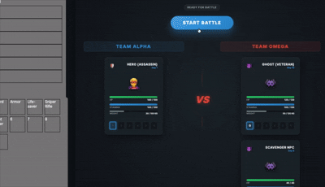

# Game Application (Vite + React)

이 디렉토리는 `webgame-project` 모노레포 내의 핵심 게임 클라이언트 앱입니다.



[게임 기획 문서 보기](../../PLAN.md) · [비주얼 스타일 가이드 보기](./DESIGN.md)

## 1. 주요 특징

- **환경**: Vite 기반의 빠르고 가벼운 개발 환경을 사용합니다. (`apps/web`, `apps/docs`의 Next.js 환경과 대조적)
- **라우팅**: `@tanstack/react-router`를 사용한 강력한 타입 안정성 기반의 파일 시스템 라우팅을 채택했습니다.
- **상태 관리**: `Jotai`를 사용하여 미세한(atomic) 단위로 전역 상태를 관리합니다. (`src/atoms`)
- **스타일링**: **Vanilla Extract (`@vanilla-extract/css`, `@vanilla-extract/recipes`)**를 통한 제로 런타임 타입 안전 CSS 방식을 사용하며, 애니메이션을 위해 `framer-motion (motion/react)`을 활용합니다.

## 2. 폴더 구조

- **`src/atoms/`**: 게임 내 인벤토리, 무기, 전역 설정 등을 관리하는 Jotai Atoms 정의.
- **`src/styles/`**: 전역 테마 토큰(`vars`)과 공통 전술 레시피(`cornerBrackets`, `page`, `fieldWidget` 등)를 정의하는 `theme.css.ts`.
- **`src/components/`**: 도메인별로 그룹화된 UI 컴포넌트들 (`Component.tsx`와 `Component.css.ts` 나란히 배치).
  - `common/`: 전역 네비게이션(`GlobalNav`), 개발 계정 게이트(`DevelopmentAccountGate`) 등 공통 컴포넌트
  - `lobby/`: 거점 로비 캐릭터 카드(`CharacterCard`), 생존자 도감(`CharacterCollection`)
  - `field/`: 필드 맵(`MapGraphCanvas`, `FieldBackground`), 상단/하단 HUD 위젯(`FieldHeader`, `FieldStatusSection`, `FieldCharacterInfo`, `FieldNavTargetSection`, `NavigationRecovery`)
  - `combat/`: 전투 캔버스(`BattleCanvas`), 적 개체(`EnemyUnit`, `CanvasEnemyUnit`), 전투 로그(`CombatLog`), 이펙트(`MeleeSlashEffect`, `RadarAttackLine`)
  - `itemSlot/`: 장비/가방 슬롯(`Equipment`, `EquipmentSlot`, `Backpack`, `BackpackSlot`, `SlotManager`)
- **`src/routes/`**: TanStack Router 기반의 페이지 경로 정의 (`*.css.ts` 스타일 파일은 `routeFileIgnorePattern`으로 라우트 트리 생성에서 제외됨). `__root.tsx`는 레이아웃의 루트 역할을 합니다.
- **`src/utils/`**: 서버와 통신하여 전투 결과를 처리하는 커스텀 훅(`useBattleData.ts`), 계산 로직(`calc.ts`) 등 유틸리티 함수 모음.

## 3. 코드 규칙

- **명명 규칙 (Naming Convention)**
  - **파일 및 컴포넌트**: React 컴포넌트 파일은 `PascalCase.tsx`, 해당 컴포넌트의 스타일 파일은 동일한 이름의 `PascalCase.css.ts`를 사용합니다. (예: `CharacterCard.tsx` + `CharacterCard.css.ts`)
  - **일반 코드**: 변수, 함수, Atom, 유틸리티 파일 등은 `camelCase`를 사용합니다. (예: `globalAtom.ts`, `weapon.ts`)
  - **Vanilla Extract 스타일**: `.css.ts` 파일에서 `camelCase`로 클래스 및 `recipe`를 export하고, 컴포넌트에서는 `import * as styles from "./Component.css"`로 가져와 `className={styles.container}` 형태로 적용합니다.

- **Export 전략**
  - **컴포넌트**: 재사용성을 고려하여 파일당 하나의 컴포넌트를 정의합니다.
  - **유틸리티 및 함수**: `src/utils` 등에 정의된 공용 함수들은 `Named Export`를 사용하여 필요한 기능만 선택적으로 가져올 수 있게 합니다.

- **컴포넌트 및 스타일 구조**
  - 해당 컴포넌트에만 종속적인 `type`이나 `interface`는 컴포넌트 정의 **상단**에 위치시킵니다.
  - 컴포넌트 스타일은 같은 도메인 폴더 내의 `*.css.ts` 파일로 분리하며, 색상·폰트·보더 토큰은 반드시 `@/styles/theme.css`의 `vars`를 참조합니다.
  - 조건부 스타일(상태별 색상, 코너 브래킷 등)은 `@vanilla-extract/recipes`의 `recipe()`를 사용하여 타입 안전하게 정의합니다.

- **로직 분리**: 복잡한 UI/상태 관련 로직은 `src/utils`에 별도 함수로 분리합니다. 핵심 게임 로직(전투 시뮬레이션 등)은 서버(`apps/server`)에서 처리하며, 클라이언트는 API를 통해 받은 데이터를 반응형으로 UI에 업데이트하는 역할에 집중합니다.
- **라우팅**: 새로운 페이지 추가 시 `src/routes` 내에 파일을 생성하고, `TanStack Router` 플러그인이 자동으로 생성하는 `routeTree.gen.ts`를 활용합니다.

## 4. 실행 및 빌드

```bash
pnpm dev    # apps/game 로컬 개발 서버 실행
pnpm build  # 게임 앱 빌드 (TypeScript 검사 포함)
```
