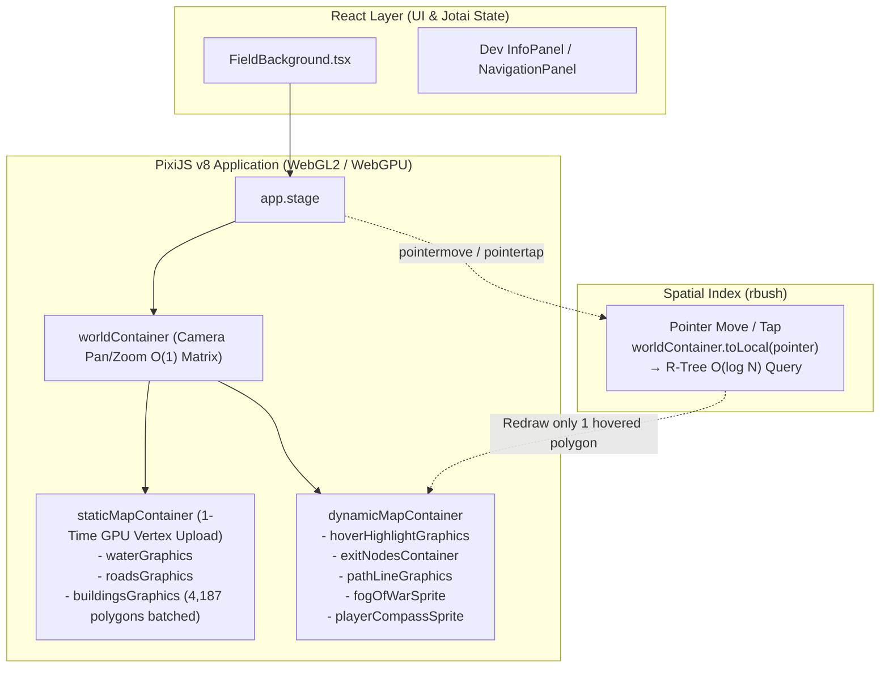

# React-Konva → PixiJS (WebGL/WebGPU) 전환 계획서

작성일: 2026-10-31 (2026-11-10 마이그레이션 완료)

대상 워크스페이스: `apps/game`

---

## 1. 배경 및 현재 프레임 드랍 원인 진단

현재 `apps/game`의 지도 탐사(`MapGraphCanvas`)와 전투 연출(`BattleCanvas`)은 HTML5 Canvas 2D Context(CPU 래스터화) 기반의 `konva` 및 `react-konva`를 사용하고 있습니다.

[`map_graph.json`](file:///Users/yugyusang/Documents/project/webgame-project/packages/types/src/assets/map_graph.json) 기준 데이터 규모는 다음과 같습니다:

| 데이터 항목 | 개수 | 현재 렌더링 방식 |
| :--- | ---: | :--- |
| 도로 교차점 (`nodes`) | 1,131개 | R-Tree 컬링 후 개별 `<Group><Circle>` 마운트 |
| 도로망 (`edges`) | 1,917개 | `main` / `major` / `minor` 3개 `<Shape sceneFunc>` 전체 순회 드로잉 |
| 건물 폴리곤 (`buildings`) | 4,187개 | R-Tree 컬링 후 개별 `<Line closed>` 마운트 |
| 수역 정점 (`water`) | 2,056개 | 단일 `<Line closed>` 폴리곤 드로잉 |

### 핵심 병목 지점 (Root Causes)

1. **드래그/줌 시 React 리렌더링 + 대량 컴포넌트 재조정(Reconciliation)**
   - [`MapGraphCanvas.tsx`](file:///Users/yugyusang/Documents/project/webgame-project/apps/game/src/components/MapGraphCanvas.tsx#L1137-L1152)의 `handleDragMove`에서 매 프레임 `setStageTransform`을 호출하여 뷰포트 경계(`visibleBounds`)를 갱신합니다.
   - `rbush` R-Tree 탐색 자체는 `0.05ms` 미만으로 매우 빠르지만, 탐색 결과로 바뀐 수백 개의 건물(`<Line>`)과 노드(`<Circle>`)가 **매 프레임 React 트리에 마운트/언마운트**되면서 메인 스레드 블로킹이 발생합니다.
2. **CPU 기반 2D 패스 재래스터화**
   - 카메라가 1px만 이동하거나 줌 배율이 바뀌어도 CPU가 화면 내 모든 폴리곤 정점과 도로 선분을 다시 스캔라인 래스터화합니다.
3. **Konva 히트 캔버스(Hit Canvas) 이중 렌더링 오버헤드**
   - 건물 4,187개와 노드에 `onClick`, `onMouseEnter`, `onMouseLeave`가 개별 바인딩되어 있어, Konva는 화면용 캔버스 외에 **숨겨진 히트 감지용 2D 캔버스(Hit Graph)에 모든 폴리곤을 고유 색상으로 한 번 더 CPU로 그립니다.**
4. **Canvas 2D `shadowBlur`의 극심한 CPU 부하**
   - 최단 경로선(`shadowBlur: 10`), 건물/노드 호버(`shadowBlur: 12`), 전투 탄환·참격·데미지 팝업에서 사용하는 `shadowBlur`는 Canvas 2D에서 매 프레임 CPU 가우시안 블러 연산을 수행하여 프레임 드랍의 직접적인 원인이 됩니다.

---

## 2. 전환 대상 컴포넌트 범위

현재 `apps/game` 내 `konva` / `react-konva` 의존성을 가진 파일은 총 **5개**입니다.

| 파일 경로 | 주요 역할 및 사용 중인 Konva 기능 | 전환 난이도 |
| :--- | :--- | :---: |
| [`MapGraphCanvas.tsx`](file:///Users/yugyusang/Documents/project/webgame-project/apps/game/src/components/field/MapGraphCanvas.tsx) | 월드 맵(수역, 도로, 건물, 노드, 탈출구), 최단 경로선, 시야 안개(Radial Gradient), 플레이어 마커, 패닝/줌/카메라 추적 및 1-Hop Gate 이동 루프 | **상** |
| [`BattleCanvas.tsx`](file:///Users/yugyusang/Documents/project/webgame-project/apps/game/src/components/combat/BattleCanvas.tsx) | 전투 중 플레이어 마커(근접 돌진 포함), 적 유닛 배치, 공격 이펙트 오케스트레이션, 플로팅 데미지 팝업(`Konva.Tween`) | **중** |
| [`CanvasEnemyUnit.tsx`](file:///Users/yugyusang/Documents/project/webgame-project/apps/game/src/components/combat/CanvasEnemyUnit.tsx) | 적 유닛 스폰 인트로 트윈, Idle 배회(`Konva.Animation`), 근접 돌진, 피격 흔들림, 이름표(`Label` + `Tag` + `Text`) | **중** |
| [`RadarAttackLine.tsx`](file:///Users/yugyusang/Documents/project/webgame-project/apps/game/src/components/combat/RadarAttackLine.tsx) | 원거리 공격 시 탄환 3연발 시차 발사(`Circle.to` 트윈) | **하** |
| [`MeleeSlashEffect.tsx`](file:///Users/yugyusang/Documents/project/webgame-project/apps/game/src/components/combat/MeleeSlashEffect.tsx) | 근접 공격 대각선 참격 커스텀 드로잉(`Shape sceneFunc` + `progress` 트윈) | **하** |

---

## 3. PixiJS 전환 아키텍처 설계

### 3.1. 기술 스택 선정: 순수 `pixi.js` v8 (명령형 Scene Graph + 경량 React 브릿지)

> [!IMPORTANT]
> **`@pixi/react` 대신 순수 `pixi.js` v8 명령형 제어를 권장하는 이유**
> 1. 현재 [`MapGraphCanvas.tsx`](file:///Users/yugyusang/Documents/project/webgame-project/apps/game/src/components/MapGraphCanvas.tsx)와 [`BattleCanvas.tsx`](file:///Users/yugyusang/Documents/project/webgame-project/apps/game/src/components/BattleCanvas.tsx)는 이미 프레임 드랍을 피하기 위해 애니메이션과 카메라 제어의 80% 이상을 `useRef` + `requestAnimationFrame` 명령형으로 처리하고 있습니다.
> 2. 4,187개의 건물과 1,917개의 도로를 React 컴포넌트 트리로 관리하면 WebGL 렌더러를 쓰더라도 React Fiber 재조정 비용이 남습니다.
> 3. 순수 `pixi.js` v8을 사용하면 React 19(`^19.1.0`)와의 호환성 문제가 전혀 없으며, 정적 맵 전체를 최초 1회 GPU 정점 버퍼(Vertex Buffer)에 올린 뒤 카메라 이동 시 **React 리렌더링 0회**로 동작시킬 수 있습니다.

### 3.2. 핵심 최적화 전략 (GPU 가속 극대화)

1. **정적 맵 지오메트리 GPU 상주화 (드래그/줌 시 리렌더링 제거)**
   - 수역(`2,056`점), 도로(`1,917`개), 건물(`4,187`개)을 마운트 시 단 1회 `PIXI.Graphics`에 일괄 드로잉하여 GPU 정점 버퍼에 업로드합니다.
   - 드래그 패닝 및 휠 줌 시에는 도형을 다시 그리지 않고 `worldContainer.position`과 `worldContainer.scale`만 변경합니다(GPU 행렬 연산 `O(1)`).
   - `stageTransform` React State는 매 프레임 갱신하지 않고, 드래그/줌 종료 시(또는 디바운스)에만 동기화하여 React 리렌더링을 완전히 차단합니다.
2. **R-Tree (`rbush`)의 역할 전환: 렌더링 컬링 → 초고속 포인터 히트 테스트**
   - 4,187개 건물 각각에 이벤트 리스너를 부착하는 대신, Stage 단일 `pointermove` / `pointertap` 이벤트에서 월드 좌표(`worldContainer.toLocal(e.global)`)를 구한 뒤 기존 `buildingsRTree` / `nodesRTree`로 후보를 찾고 정밀 `pointInPolygon` 판정을 수행합니다.
   - 호버된 단일 건물/노드만 별도의 `hoverHighlightGraphics`에 덧그려주므로 CPU 히트 캔버스 오버헤드가 `0`이 됩니다.
3. **`shadowBlur` 제거 및 GPU 친화적 발광(Glow) 처리**
   - **최단 경로선 / 호버 하이라이트 / 참격 이펙트**: Canvas 2D `shadowBlur` 대신 넓은 반투명 외곽선(Outer Glow Stroke, 예: `width: 12, alpha: 0.25`) + 중심 코어 선(`width: 4, alpha: 0.9`)의 2-Pass 스트로크로 대체하여 드로우콜 증가 없이 네온 효과를 구현합니다.
   - **원거리 탄환 / 적 유닛 구체**: 방사형 그라데이션이 적용된 작은 원형 텍스처를 1회 생성해 `PIXI.Sprite`로 재사용합니다.
4. **시야 안개(Fog of War) 텍스처 스프라이트화**
   - 매 프레임 거대한 원형 그라데이션을 그리는 대신, 오프스크린 캔버스로 반투명 비네트 텍스처를 1회 생성한 뒤 `PIXI.Sprite`의 위치만 플레이어 좌표(`playerCoords`)에 동기화합니다.
5. **경량 트윈(Tween) 유틸리티 도입**
   - 기존 `Konva.Tween`을 대체할 수 있는 `pixi.js` Ticker 기반의 경량 `tween()` 유틸리티(`src/utils/pixiTween.ts`)를 작성하여 스폰 인트로, 데미지 팝업, 카메라 줌인 트랜지션을 깔끔하게 이관합니다.

---

## 4. 단계별 작업 계획 (Phased Execution Plan)

### Phase 1: 패키지 설치 및 PixiJS 기반 유틸리티 구축
- **작업 내용**:
  1. `apps/game`에 `pixi.js` 설치 (`pnpm add pixi.js --filter game`)
  2. `apps/game/src/utils/pixiTween.ts` 생성:
     - `EaseOut`, `EaseIn`, `EaseInOut`, `ElasticEaseOut`, `Linear` 이징 함수 및 `PIXI.Ticker` 기반 트윈 제어기 구현
  3. `apps/game/src/utils/pixiTextures.ts` 생성:
     - 나침반 SVG(`compass.svg`) 텍스처 로더, 시야 안개(Fog of War) 방사형 그라데이션 텍스처 생성기, 네온 구체(Enemy/Bullet) 텍스처 생성기 구현

### Phase 2: 전투 캔버스 및 이펙트 컴포넌트 전환 (`BattleCanvas` 계열)
- **작업 내용**:
  1. [`BattleCanvas.tsx`](file:///Users/yugyusang/Documents/project/webgame-project/apps/game/src/components/BattleCanvas.tsx) 내부의 Pixi `Application` 라이프사이클 구성 (`ResizeObserver` 연동, 투명 배경 `backgroundAlpha: 0`)
  2. 하위 연출 모듈을 PixiJS `Container` / `Graphics` / `Text` 컨트롤러(또는 서브 컴포넌트)로 전환:
     - [`RadarAttackLine.tsx`](file:///Users/yugyusang/Documents/project/webgame-project/apps/game/src/components/RadarAttackLine.tsx): 3연발 시차 탄환 스프라이트 트윈
     - [`MeleeSlashEffect.tsx`](file:///Users/yugyusang/Documents/project/webgame-project/apps/game/src/components/MeleeSlashEffect.tsx): `PIXI.Graphics` 기반 대각선 참격 드로잉 애니메이션
     - [`CanvasEnemyUnit.tsx`](file:///Users/yugyusang/Documents/project/webgame-project/apps/game/src/components/CanvasEnemyUnit.tsx): 스폰 인트로, Idle 배회(Ticker), 근접 돌진, 피격 흔들림, 적 이름 태그(`Graphics` 배경 + `PIXI.Text`)
     - `CanvasDamagePopup`: 크리티컬/일반 데미지 텍스트 2단계 팝업 트윈
- **검증**: 전투 진입 시 플레이어 마커 회전, 근접 돌진, 원거리/근접 이펙트, 데미지 팝업, 적 사망 제거가 기존과 동일하게 동작하는지 확인.

### Phase 3: 월드 맵 캔버스 전환 (`MapGraphCanvas.tsx`)
- **작업 내용**:
  1. PixiJS `Application` 및 레이어 계층(`worldContainer`) 구성:
     - `staticMapLayer`: 수역 폴리곤, 3종 도로망(`main`, `major`, `minor`), 건물 폴리곤 4,187개 일괄 배칭 드로잉
     - `interactiveOverlayLayer`: 호버된 건물/노드 하이라이트 `Graphics`, 탈출구(`EXIT`) 마커 그룹
     - `navigationLayer`: 최단 경로 네온 라인(`pathLineGraphics`), 타겟 목적지 비콘
     - `playerLayer`: 시야 안개 스프라이트(`sightMaskSprite`), 플레이어 나침반(`playerMarkerSprite`)
  2. 인터랙션 및 카메라 이관:
     - 포인터 드래그 패닝(`pointerdown`, `pointermove`, `pointerup`) 및 커서 중심 휠 줌(`0.05x ~ 10x`) 구현
     - `buildingsRTree` / `nodesRTree` + 다각형 내부 판정(`pointInPolygon`)을 결합한 건물/노드 호버(`#hud-hover-detail` 갱신) 및 클릭(`handleTargetSelect`) 구현
     - 전투 돌입 시 플레이어 중심 3.0배율 카메라 줌인 트윈 연동
  3. 1-Hop Gate 네비게이션 RAF 루프 연동:
     - 기존 서버 응답 대기(1-Hop Gate), 경로 꼬리 깎기, 카메라 부드러운 추적(Lerp) 로직은 그대로 유지하되, 렌더 타겟만 Konva Node Ref에서 Pixi Sprite/Graphics Ref로 교체

### Phase 4: 레거시 의존성 정리 및 최종 검증
- **작업 내용**:
  1. `apps/game/package.json`에서 `konva`, `react-konva`, `use-image` 제거
  2. 타입 검사(`pnpm check-types`), 린트(`pnpm lint`), 빌드(`pnpm build`) 수행 및 에러 0건 확인
  3. 개발자 패널(`?dev=true`)에서 드래그/줌 FPS 및 메모리 사용량 확인

---

## 5. 사전 확인 및 결정 필요 사항

구현에 착수하기 전에 아래 두 가지 방향에 대해 의견 주시면 맞춰서 진행하겠습니다:

1. **선언형(`@pixi/react`) vs 명령형(순수 `pixi.js` v8) 선택**:
   - 본 계획서는 **최고 성능(드래그/줌 시 React 리렌더링 0회)과 React 19 완벽 호환**을 위해 **순수 `pixi.js` v8(명령형 Scene Graph + 커스텀 훅/모듈 분리)** 방식을 기준으로 작성했습니다. 이 방향으로 진행해도 괜찮을까요?
2. **작업 진행 순서**:
   - 계획서의 순서대로 **전투 캔버스(`Phase 2`) → 월드 맵(`Phase 3`)** 순으로 단계별로 끊어서 진행할지, 혹은 프레임 드랍 체감이 가장 큰 **월드 맵(`MapGraphCanvas`)부터 먼저 전환**할지 선호하시는 순서가 있나요?
