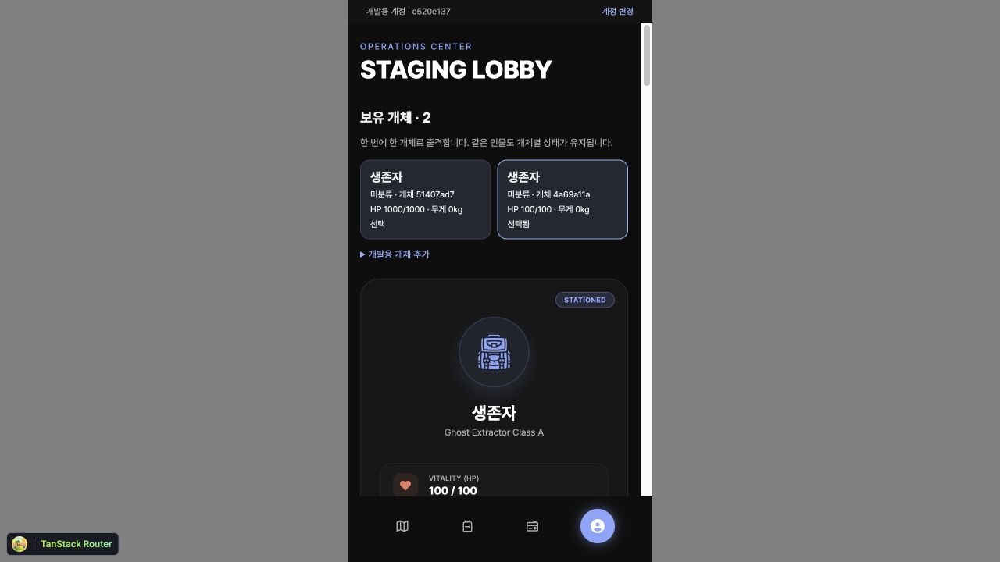
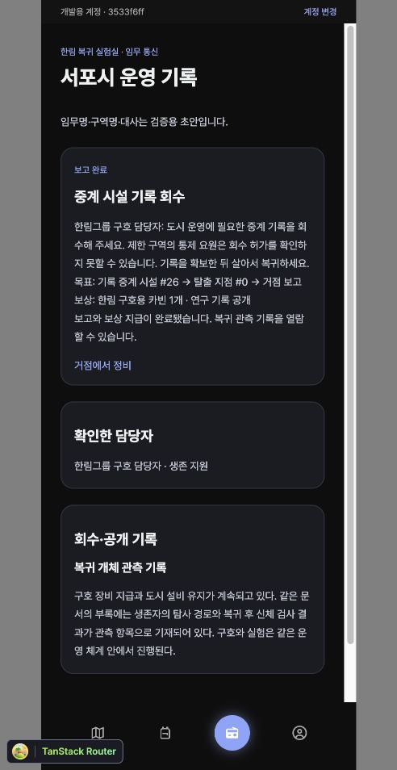

# 기본 탐사·복수 개체·고스트 검증

외부 DB와 기존 `.env`는 변경하지 않았다. 로컬 일회용 PostgreSQL 16에만 마이그레이션을 적용했다.

## 기본 탐사 (07–08)

이전 브라우저 검증에서 출격 → 건물 이동 → 이동 중 새로고침 → 같은 요청 복구 → 전투 승리 → 보상 → 탈출 → 창고 반영을 확인했다. 소총 3개와 획득 장비 1개의 창고 수량, 장착 장비 1개와 무게 1kg을 확인했다.

별도 로컬 개체의 체력을 1로 설정해 출격 → 전투 패배 → 장비·가방 소실 → 최대 체력·스태미나로 복귀 → 창고 장비 재장착 → 재출격 → 탈출 → 새로고침을 확인했다. 창고 수량은 사망으로 줄지 않았다. 통신 시간 초과·중복 요청·가방 포화는 자동 검증에 포함했다.

## 복수 개체 (09)

- 동일 인물·세계선의 두 개체를 각각 추가하고 고유 개체 번호로 구분했다.
- 첫 개체 HP 1000·장비 1개, 두 번째 개체 HP 100·장비 없음이 선택 시 따로 표시됐다.
- 두 번째 개체로 출격·탈출한 뒤 새로고침해도 선택과 상태가 유지됐다.
- 동시 선택·출격, 타 사용자 조작, 탐사 중 다른 개체를 통한 창고 접근을 테스트 DB에서 검증했다.

## 데이터 이전

기존 스키마에 `src/testing/migrationFixture.sql`의 검증 데이터를 만든 뒤 탐사 세션·캐릭터 수집 마이그레이션을 적용했다. 기존 개체 ID, 이름, HP 37/150, 스태미나 42, 무게 6, 가방 2개, 창고 3개, 진행 중 탐사 위치 26·라운드 4를 보존했다. 선택 개체는 기존 개체로 연결됐다. 시드는 실행하지 않았다.

## 고스트 기록·매칭 (10)

다른 계정의 위치·라운드 기록을 조회하고, 장비 마스터 수정 후에도 기록한 공격력은 유지되는지 확인했다. 같은 이동·출격 재시도의 기록 중복, 자기 계정 기록, 다른 위치, 허용 라운드 밖, 만료 기록, 이전 규칙 기록을 검증했다. 임의 능력치 저장 API는 거부하고 `day` 대신 `round`만 받는다.

## 검증 결과

- 타입 검사·단위/API 테스트 36건·전체 빌드·린트 통과.
- 로컬 PostgreSQL 통합 테스트: 기본 흐름 21건 → 복수 개체 24건 → 고스트 기록 27건 → 고스트 전투 29건 → 구역·임무 포함 34건 통과.
- 남은 경고: 게임 빌드의 큰 묶음 파일, 서버 ESLint 설정 파일의 모듈 형식 안내.
- 실제 로그인과 외부 DB 배포는 이 검증 범위에 포함하지 않는다.

## 고스트 전투·구역·임무 (11–14)

고스트 승리·사망을 모두 실제 DB에서 정산했다. 동일 요청 재전송과 같은 탐사 내 동일 기록 재사용을 차단했고, 상대 원본 개체의 체력·장비·가방이 바뀌지 않는지 확인했다. 구역·중첩 상태별 안전·지원·적대 조건, 한림 요원의 소속·역할·적대 이유, SF 명칭과 독립적인 장비 효과도 검증했다.

임무 수락과 보고의 동시 요청이 각각 지원·보상을 한 번만 지급하고, 회수 후 사망하면 다시 회수해야 하는지 확인했다. 초기 응답에는 경영 책임자 정보가 없고, 단일 인물 단계에는 내부 개체 ID가 없으며, 후기 단계에서만 별도 개체 ID 두 개를 공개하는 필터를 확인했다. 후기 단계는 검증용 표식이며 실제 후속 서사가 완성됐다는 뜻은 아니다.

브라우저에서 빈 소지품의 생존자 계정으로 다음을 완료했다.

1. 임무 수락으로 한림 구호용 카빈 1개 수령.
2. 창고 → 가방 이동 → 장착 후 출격.
3. 시설 26으로 이동해 다른 탐사의 ‘생존자’ 고스트와 전투. 출처 개체와 2라운드 기록 시점 표시 확인.
4. 승리 후 HP 92/100·스태미나 96/100, 기록 확보, 전리품 1개 확인.
5. 노드 0으로 돌아와 탈출. 가방 0개·장착 카빈 유지·무게 3kg, 전리품 창고 이관 확인.
6. 임무 보고 후 보상 카빈 1개와 복귀 개체 관측 기록 공개 확인.
7. 새로고침 후에도 완료 상태·공개 기록 유지 확인.

DB에서도 임무 COMPLETE·보고 시각 존재·고스트 정산 1건·가방 0개·창고의 카빈 1개와 잔상 장비 1개·원본 고스트 HP 40 및 장비 1개 보존을 확인했다.

## 최종 실행 확인

- 새 빈 로컬 DB에 7개 마이그레이션을 처음부터 적용했다. 현재 Prisma 스키마와의 차이는 없었다.
- 안내한 검증 서버 실행으로 계정 2개·개체 2개·유효 고스트 기록 5개·탈출한 원본 탐사 1건을 준비했다. 정상 종료 뒤 계정·개체·고스트 기록이 모두 0개로 정리되는지 확인했다.
- 빌드된 서버의 `/health`와 이전 개체 조회를 실제 포트에서 확인했다. 개체 ID·HP 37·장비 1개·탐사 4라운드·초기 세계선 연결을 유지했다.
- 마지막 변경 후 단위/API 36건·DB 통합 34건·타입·린트·빌드를 다시 통과했다. 외부 DB·기존 연결 설정은 변경하지 않았다.

